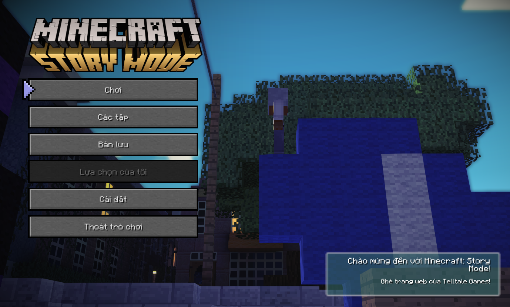
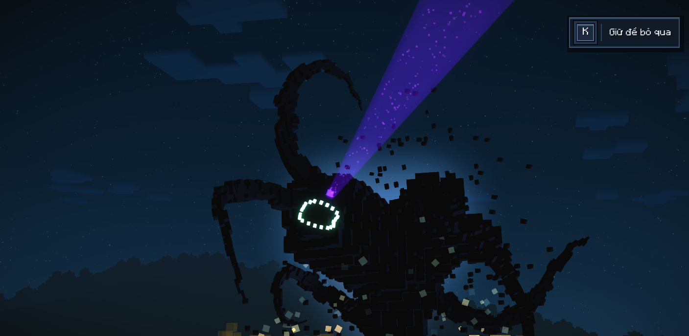
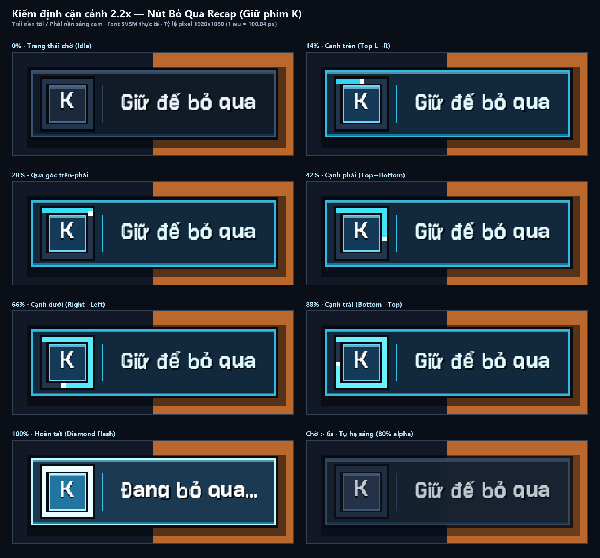
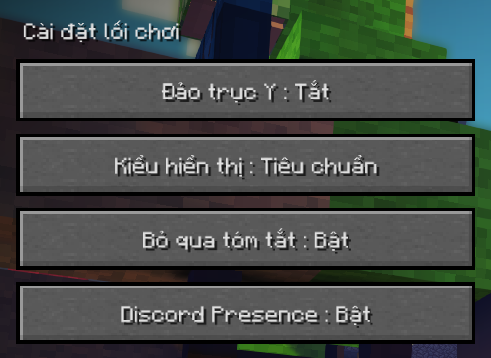
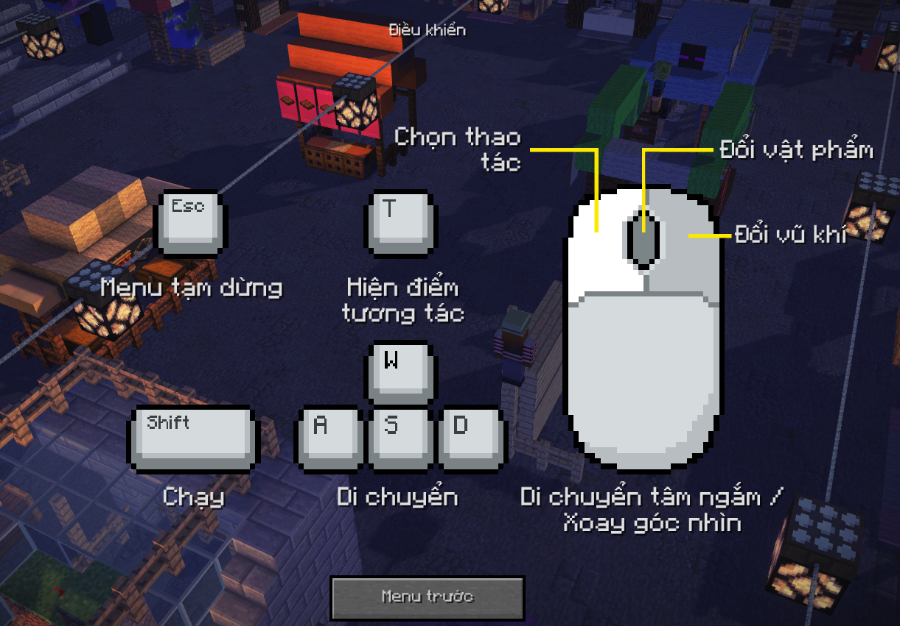
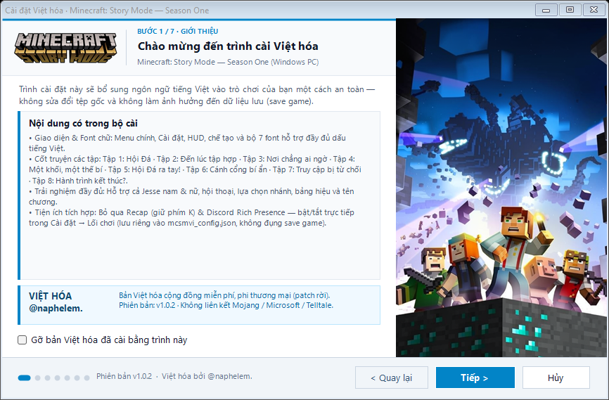

# Minecraft: Story Mode — Việt hóa cộng đồng

**Dự án Việt hóa miễn phí, phi thương mại cho phiên bản Windows PC hợp pháp bởi `@naphelem.`**

[Trang giới thiệu & Tải nhanh (GitHub Pages)](https://nhinquanhlancuoi9999.github.io/mcsm-vi/) ·
[Tải bản mới nhất (Releases)](https://github.com/NhinQuanhLanCuoi9999/mcsm-vi/releases) ·
[Báo lỗi (GitHub Issues)](https://github.com/NhinQuanhLanCuoi9999/mcsm-vi/issues)

 

---

## Trạng thái phát hành theo mùa

Kho lưu trữ này phân tách bản phát hành theo **hậu tố tag** để bạn dễ nhận biết và để trang web tĩnh tự động đồng bộ bản mới nhất:

| Mùa trò chơi | Quy ước tag | Trạng thái | Bản mới nhất | Nội dung |
| :--- | :---: | :---: | :---: | :--- |
| **Season One** | `*-a` | **Đã phát hành** | [`v1.0.2-a`](https://github.com/NhinQuanhLanCuoi9999/mcsm-vi/releases/tag/v1.0.2-a) | Trọn bộ Tập 1–8, giao diện, 7 font pixel tiếng Việt, tiện ích & DirectX 9.0c |
| **Season Two** | `*-b` | **Sắp ra mắt** | *Đang chờ phát hành* | Cập nhật sau bản Season One — tự mở tải khi tag `*-b` được đăng |

> [!TIP]
> **Cách tải nhanh:** Truy cập [Trang giới thiệu](https://nhinquanhlancuoi9999.github.io/mcsm-vi/) hoặc vào thẳng mục [Releases](https://github.com/NhinQuanhLanCuoi9999/mcsm-vi/releases), xem ghi chú phiên bản và tải tệp **`MCSM-Vietnamese-Setup.exe`** (`~11.22 MB`).

---

## Ảnh chụp thực tế trong game

### Nút bỏ qua tóm tắt đầu tập (`[K | Giữ để bỏ qua]`)

Huy hiệu nằm gọn ở **góc trên-phải**, hoàn toàn không che phụ đề tiếng Việt phía dưới. Giữ phím `K` để bỏ qua đoạn tóm tắt đầu các tập **2, 3, 4, 6, 7, 8**:

<table>
  <tr>
    <td width="58%" align="center">
      
       <b>Ảnh chụp thực tế trong game</b> (góc trên-phải, tách biệt vùng phụ đề)
    </td>
    <td width="42%" align="center">
      
       <b>Cận cảnh 8 trạng thái nút Skip</b> (chạy viền xanh khi giữ phím K)
    </td>
  </tr>
</table>

### Giao diện cài đặt, điều khiển & trình cài đặt

<table>
  <tr>
    <td width="50%" align="center">
      
       <b>Cài đặt → Lối chơi:</b> bật/tắt nhanh Bỏ qua tóm tắt & Discord Presence ngay trong game
    </td>
    <td width="50%" align="center">
      
       <b>Hướng dẫn điều khiển:</b> dịch đồng bộ phím, chuột, HUD và bảng chế tạo
    </td>
  </tr>
  <tr>
    <td colspan="2" align="center">
      
       <b>Trình cài đặt 1 tệp duy nhất:</b> chọn từng tập muốn cài, hỗ trợ bổ sung DirectX khi cần và gỡ sạch chỉ với 1 ô tích
    </td>
  </tr>
</table>

---

## Điểm nổi bật của bản Việt hóa Season One

- **Trọn bộ 8 tập cốt truyện (`37,086` dòng nội dung):** Đầy đủ cho cả nhân vật **Jesse nữ & Jesse nam**, hộp thoại, lựa chọn nhánh, bảng hiệu 3D trong cảnh, màn hình kính VR của Harper (Tập 7), danh đề mở đầu và danh đề cuối tập.
- **Bộ 7 font pixel tiếng Việt đúng chất Minecraft:** Giữ nguyên nét chữ vuông đặc trưng của trò chơi với đầy đủ dấu tiếng Việt; được dựng trực tiếp trên máy từ bản game hợp pháp khi cài đặt, không chứa tệp tài nguyên bản quyền trong bộ cài.
- **Tiện ích tích hợp tùy chọn (bật/tắt ngay trong `Cài đặt → Lối chơi`):**
  - **Bỏ qua tóm tắt (giữ phím `K`):** Hỗ trợ Tập 2, 3, 4, 6, 7, 8 với huy hiệu đặt góc trên-phải không đè phụ đề.
  - **Discord Rich Presence:** Tự động hiển thị trạng thái **Menu chính** hoặc **Tập 1–8 kèm `%` tiến độ** theo thời gian thực trên hồ sơ Discord.
- **Cài 1 lần, an toàn & dễ gỡ:**
  - Chỉ cần tải một tệp **`MCSM-Vietnamese-Setup.exe`** duy nhất (không cần tự cài thêm Python, Lua hay Visual C++ Runtime).
  - Tự kiểm tra và cài bổ sung **DirectX 9.0c** (bộ tệp chính chủ có chữ ký số Microsoft) nếu máy Windows mới chưa có sẵn.
  - **Không sửa bất kỳ tệp gốc nào của game** và **không ảnh hưởng bản lưu (save game)**; tương thích bản PC hợp pháp (**Steam / GOG / bản cài rời**).

### Danh sách 8 tập Season One

| Tập | Tên tiếng Việt | Tên gốc tiếng Anh | Bỏ qua Recap (phím `K`) |
| :---: | :--- | :--- | :---: |
| **1** | **Hội Đá** | *The Order of the Stone* | Không có recap đầu tập |
| **2** | **Đến lúc tập hợp** | *Assembly Required* | Có hỗ trợ |
| **3** | **Nơi chẳng ai ngờ** | *The Last Place You Look* | Có hỗ trợ |
| **4** | **Một khối, một thế bí** | *A Block and a Hard Place* | Có hỗ trợ |
| **5** | **Hội Đá ra tay!** | *Order Up!* | Mở tuyến mới (không recap) |
| **6** | **Cánh cổng bí ẩn** | *A Portal to Mystery* | Có hỗ trợ |
| **7** | **Truy cập bị từ chối** | *Access Denied* | Có hỗ trợ |
| **8** | **Hành trình kết thúc?** | *A Journey's End?* | Có hỗ trợ |

---

## Hướng dẫn cài đặt & gỡ bỏ

1. **Thoát hoàn toàn game** nếu đang mở.
2. Tải **`MCSM-Vietnamese-Setup.exe`** từ bản phát hành [`v1.0.3-a`](https://github.com/NhinQuanhLanCuoi9999/mcsm-vi/releases/tag/v1.0.3-a) (hoặc bản `-a` mới nhất trong [Releases](https://github.com/NhinQuanhLanCuoi9999/mcsm-vi/releases)).
3. Mở bộ cài, chọn đúng thư mục cài đặt *Minecraft: Story Mode* trên máy bạn, giữ nguyên các mục đã tích sẵn rồi nhấn **Tiếp → Cài đặt**.
4. Vào game, mở **Cài đặt → Âm thanh / Hình ảnh** rồi **bật Phụ đề** để hiển thị đầy đủ lời thoại tiếng Việt và có trải nghiệm tốt hơn. Bạn cũng có thể bật/tắt **Bỏ qua tóm tắt** hoặc **Discord Presence** bất kỳ lúc nào trong **Cài đặt → Lối chơi**.
5. **Muốn quay về tiếng Anh gốc?** Mở lại `MCSM-Vietnamese-Setup.exe`, tích ô **Gỡ bản Việt hóa đã cài bằng trình này** ở Bước 1 và làm theo hướng dẫn.

> [!NOTE]
> **Lưu ý Windows SmartScreen:** Do đây là bản phát hành cộng đồng phi thương mại chưa mua chứng thư ký số thương mại, Windows có thể hiện cảnh báo *Windows protected your PC*. Bạn có thể đối chiếu mã **SHA-256** của tệp cài với thông tin trên trang Release trước khi nhấn **More info → Run anyway**:
> - Bản `v1.0.3-a` (`MCSM-Vietnamese-Setup.exe`): `cf41fd86b7fb5d66e89d1bf6f2abf110b0aa96d25035f2109123db4a33ce6c51`

---

## Báo lỗi & Góp ý

Nếu trong quá trình cài đặt hoặc chơi game bạn gặp lỗi dịch thuật, sai xưng hô, lỗi hiển thị chữ/khung, nút Bỏ qua Recap, Discord Presence hay lỗi cài đặt, vui lòng mở một Issue để dự án tiếp nhận và khắc phục:

- **Tạo báo lỗi mới:** https://github.com/NhinQuanhLanCuoi9999/mcsm-vi/issues/new
- **Xem các lỗi đang theo dõi:** https://github.com/NhinQuanhLanCuoi9999/mcsm-vi/issues

Khi báo lỗi, bạn nên kèm theo:
- **Ảnh chụp màn hình** chỗ hiển thị sai hoặc thông báo lỗi.
- **Tên tập & phân đoạn** đang chơi (ghi thêm Jesse nam/nữ nếu liên quan xưng hô).
- Tệp nhật ký `Archives\.mcsmvi\install.log` nếu là sự cố khi cài đặt.

---

## Cấu trúc trang web tĩnh (GitHub Pages)

Kho lưu trữ này đồng thời chứa mã nguồn trang giới thiệu tĩnh (không cần bước build):

- `index.html`, `styles.css`, `app.js` — Trang giới thiệu tự đồng bộ bản phát hành mới nhất từ GitHub Releases theo tag `-a` / `-b`.
- `.nojekyll` — Phục vụ tệp tĩnh trực tiếp trên GitHub Pages.
- `assets/` — Ảnh chụp thực tế trong game, ảnh bìa/logo hai mùa và font web pixel tiếng Việt (`Pixelcraft.woff2`).

---

## Bản quyền & Ghi công

- **Minecraft: Story Mode** cùng toàn bộ nhãn hiệu, nhân vật, đồ họa, âm thanh và dữ liệu gốc thuộc quyền sở hữu của **Mojang / Microsoft / Telltale Games**.
- Dự án Việt hóa cộng đồng này (`@naphelem.`) hoàn toàn **miễn phí, phi thương mại**, không phân phối tệp game gốc và không kèm crack; người dùng cần sở hữu bản game Windows PC hợp pháp.
- Trang web giới thiệu sử dụng font hiển thị **Pixelcraft** (dự án mã nguồn mở từ cộng đồng lấy cảm hứng từ Minecraft, hỗ trợ đầy đủ dấu tiếng Việt).
